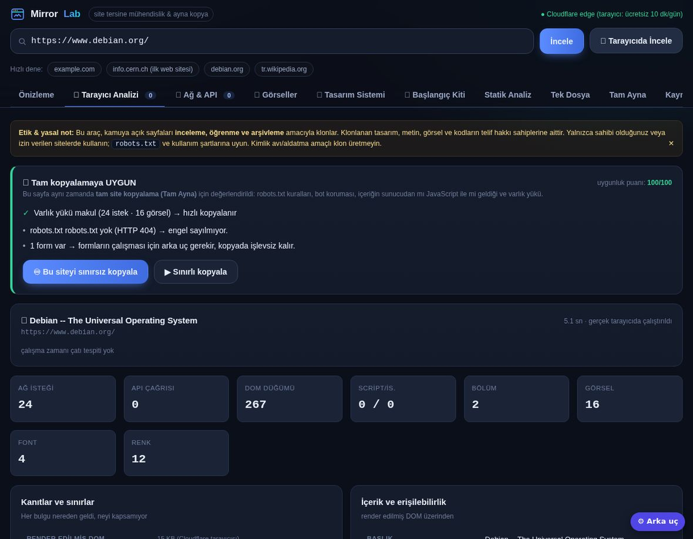
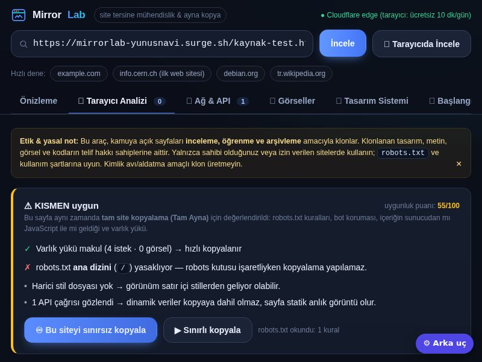
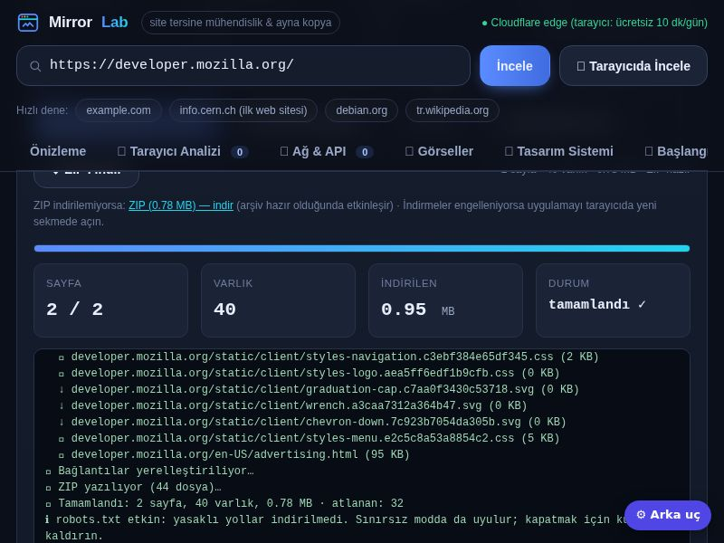
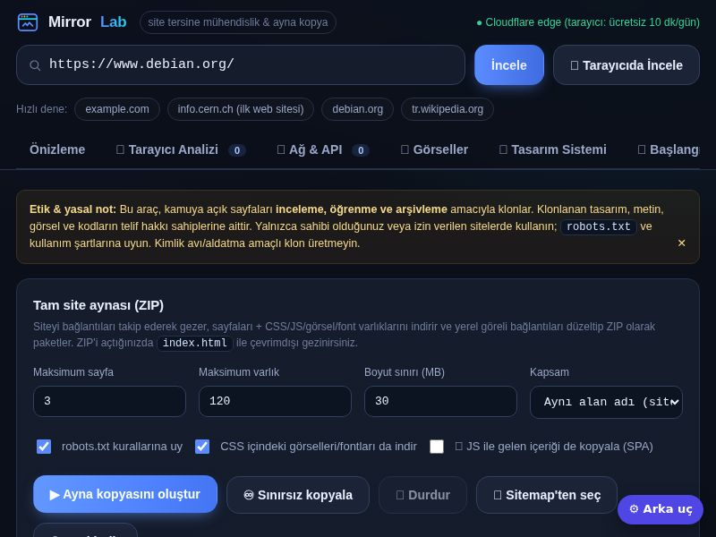
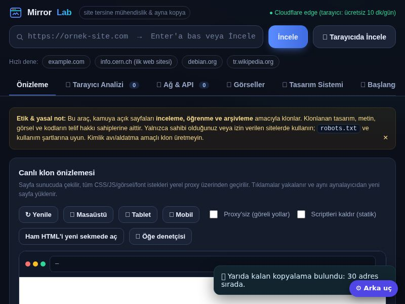
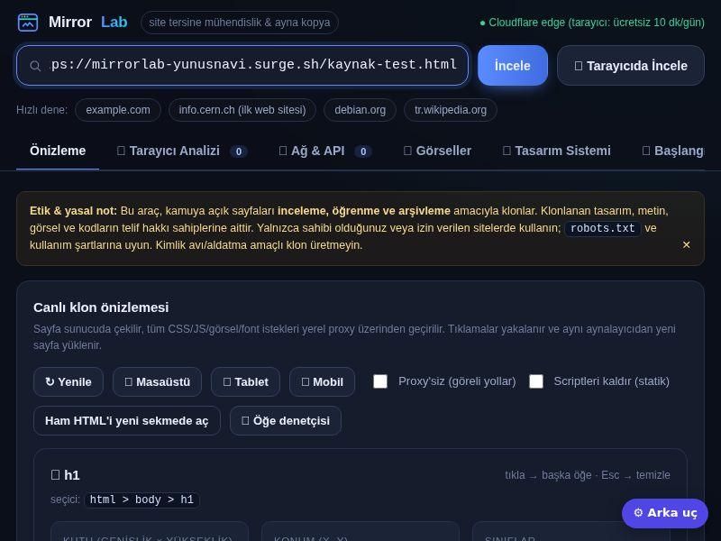
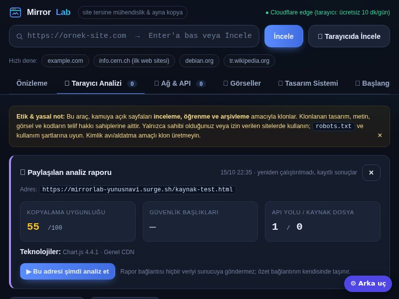
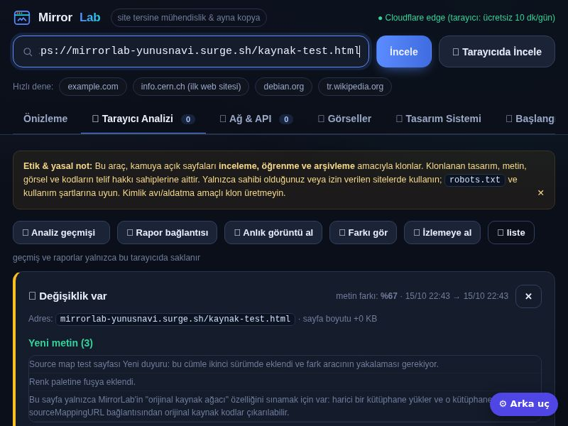

# 🧪 MirrorLab — Site Tersine Mühendislik Stüdyosu

[](LICENSE)
[](https://caylakyunus5.github.io/mirrorlab/)
[](https://mirrorlab-edge.yunusnavi.workers.dev/api/health)
[]()

> Herhangi bir web sitesini **gerçek bir tarayıcıda çalıştırıp** içini dışına çıkaran, tarayıcıda çalışan
> (sunucu gerektirmeyen) bir tersine mühendislik stüdyosu. Analiz eder, klonlar, tek dosyaya çevirir,
> tam site aynasını ZIP olarak indirir, teknoloji/API/kaynak kodlarını çıkarır, değişimi izler.
> Yaklaşım **REA (Reverse Engineer Anything)** fikrinden ilham alır: hedefi gerçek ortamında çalıştır,
> gözlemle, çıkarımı **kanıt + sınır** ile birlikte raporla.

**Canlı yüzeyler (hepsi ücretsiz, kart istemez):**
[GitHub Pages](https://caylakyunus5.github.io/mirrorlab/) ·
[Surge](https://mirrorlab-yunusnavi.surge.sh) ·
[Motor (Cloudflare Worker)](https://mirrorlab-edge.yunusnavi.workers.dev)

Depo: [github.com/caylakyunus5/mirrorlab](https://github.com/caylakyunus5/mirrorlab) · Lisans: MIT

---

## 🎬 Ne yapabilir?

| Özellik | Açıklama |
|---|---|
| 🔬 **Tarayıcı analizi** | Headless Chrome ile ağ kaydı, API gövdeleri, render edilmiş DOM, bölüm haritası, tasarım token'ları, ekran görüntüleri |
| 🧭 **Uygunluk kararı** | "Bu site tam kopyalamaya uygun mu?" — robots.txt, bot koruması, SPA, varlık yükü → 100 üzerinden puan ve gerekçe |
| 🧬 **REA derinliği** | Teknoloji/sürüm envanteri · güvenlik başlıkları raporu · **OpenAPI 3.1** şema taslağı · source map'ten **orijinal kaynak ağacı** |
| 📦 **Tam Ayna (ZIP)** | Sayfaları gezer, varlıkları indirir, bağlantıları yerelleştirir; **DEFLATE** ile ~%25 küçük ZIP; sitemap'ten sayfa seçme; SPA modu (JS sonrası DOM) |
| ♾️ **Sınırsız mod** | Sayfa/varlık sınırı yok; ZIP doğrudan diske akıtılır, duraklatılabilir ve **yarıda kalan kopya sürdürülebilir** |
| 🧪 **Öğe denetçisi** | Klon üzerinde tıkla → etiket, sınıf, kutu modeli, hesaplanmış stiller, HTML parçası |
| 🕘 **Geçmiş + paylaşılabilir rapor** | Son 30 analiz tarayıcıda; özet bağlantıya gömülür (`#rapor=…`), açan kişi sonucu yeniden çalıştırmadan görür |
| 👁 **İzleme ve fark** | İki sürüm arasındaki metin/başlık/varlık/renk/font değişimi; izlemeye alınan adresler için bildirim ve tasarım token geçmişi |

## 📸 Ekran görüntüleri

| Kopyalama uygunluğu | REA derinliği |
|---|---|
|  |  |

| Sitemap'ten sayfa seçimi | Tam Ayna + DEFLATE |
|---|---|
|  |  |

| Yarıda kalan kopyayı sürdür | Öğe denetçisi |
|---|---|
|  |  |

| Paylaşılabilir rapor | İzleme ve fark |
|---|---|
|  |  |

## ⚡ Hızlı başlangıç

```bash
./run.sh                 # → http://localhost:8000  (yalnızca Python 3 gerekir)
```

Arayüzde bir adres yazıp **İncele** deyin; her şey doğrudan kamuya açık sayfadan çalışır —
"motor bağla / ayar yap" adımı yoktur. Kendi sunucunuzda yayınlamak için `DEPLOY.md` dosyasına bakın.

---

## İki katmanlı mimari

| Katman | Ne yapar | Gereksinim |
|---|---|---|
| **Tarayıcı motoru** (`engine.js`) | Headless Chrome ile sayfayı açar: ağ kaydı, API yanıt gövdeleri, render edilmiş DOM, bölüm haritası, tasarım sistemi, ekran görüntüleri, akış sondası. **Yerel Chrome ya da uzak tarayıcı (CDP)** — ör. Cloudflare Browser Rendering | Node.js + Puppeteer (+ Chrome **veya** `MIRRORLAB_BROWSER_WS`) |
| **Edge katmanı** (`deploy/cloudflare/worker.js`) | Sunucusuz klonlama: önizleme, varlık proxy'si, statik analiz, tek dosya (HTMLRewriter) | Cloudflare hesabı (ücretsiz) |
| **Statik motor** (`server.py`) | Hızlı HTML/CSS/getirme, proxy önizleme, tek dosya dışa aktarma, tam site aynası (ZIP), robots.txt | Yalnızca Python standart kütüphanesi |

Tarayıcı motoru yoksa uygulama çalışmaya devam eder; "🔬 Tarayıcıda İncele" butonu eksik kurulumu size söyler.

## Sekmeler

| Sekme | İçerik |
|---|---|
| **Önizleme** | Klonlanmış sayfa iframe'de; tüm istekler yerel proxy'den geçer, tıklamalar izlenir. Masaüstü/tablet/mobil genişlik. |
| **🔬 Tarayıcı Analizi** | Çalışma zamanı çatı tespiti, **kanıt & sınırlar tablosu**, içerik/erişilebilirlik özeti, etkileşim akışları, sayfa haritası, script bundle'ları + source map durumu. |
| **🌐 Ağ & API** | Gerçek istek listesi (yöntem, tür, durum, boyut, süre, filtre) + yakalanan **API uç noktaları**: yanıt şeması ve örnek gövde. |
| **🖼️ Görseller** | Masaüstü / tam sayfa / mobil ekran görüntüleri + bölüm bazlı kırpmalar. |
| **🎨 Tasarım Sistemi** | Render edilmiş elementlerden hesaplanmış renk paleti, tipografi, boşluk/köşe/gölge ölçeği ve **bileşen stilleri** (buton, input, kart, nav). |
| **📦 Başlangıç Kiti** | Analizi kendi projenizde kullanılacak ZIP'e çevirir: `index.html` + `styles/tokens.css` + `assets/` + `data/api-examples.md` + mimari `README.md`. |
| **Statik Analiz** | Hızlı tarayıcısız analiz (varlık envanteri, DOM ağacı, meta, tasarım renkleri). |
| **Tek Dosya** | Tüm varlıkları gömülü tek `.html` (çevrimdışı açılır) veya mutlak URL'li hafif kopya. |
| **Tam Ayna** | Siteyi gezer, varlıkları indirir, bağlantıları yerelleştirir → gezilebilir ZIP arşivi. |
| **Kaynak** | Ham HTML; kopyala/indir. |

## Tarayıcı motoru ne topluyor?

```
engine.js <config.json>  →  kanıt paketi (JSON)
├── network[]     her istek: yöntem, tür, durum, mime, boyut, süre, başlatıcı, ilgili başlıklar
├── api[]         XHR/fetch çağrıları: yinelenme sayısı, yanıt şeması, ilk 12 KB gövde
├── sections[]    bölüm haritası: seçici yolu, konum, yükseklik, arka plan, başlık, içerik yoğunluğu
├── design{}      renkler, fontlar, punto/ağırlık, boşluk, köşe, gölge + bileşen örnekleri
├── screenshots{} masaüstü (1440×900), tam sayfa (16 000 px'e kadar), mobil (390×844), bölüm kırpmaları
├── scripts[]     bundle listesi + `.map` erişilebilirliği ve kaynak dosya adları
├── flows[]       gezinme bağlantılarına tıklayıp gözlemlenen istekler
├── frameworks[]  çalışma zamanı tespiti (window.React, __NEXT_DATA__, dataLayer, gtag…)
├── seo/headings/forms/links/images/a11y  içerik çıkarımı
├── evidence{}    her bulgunun kaynağı
└── limits[]      neyin kapsam dışı olduğu (dürüst liste)
```

Zaman/veri bütçeleri: toplam analiz ~75 sn, API gövdesi 12 KB, HTML 3 MB, tam sayfa görüntüsü 16 000 px ile sınırlıdır.

## ☁️ Barındırma seçenekleri (hepsi ücretsiz katman)

Ayrıntılı rehber: **[DEPLOY.md](DEPLOY.md)** — beş ücretsiz yolun karşılaştırması ve adım adım kurulum.

* ~~Hugging Face Spaces (Docker)~~ — **Temmuz 2026'dan beri ücretli** (Docker Space = PRO $9/ay); ücretsiz hesapla yalnızca statik Space açılabiliyor.
* **Google Cloud Run** — uyumaz, ücretsiz kota: ayda 2M istek + 180.000 vCPU-sn; `./deploy/cloudrun.sh`.
* **Render (ücretsiz plan)** — `render.yaml` hazır; 512 MB RAM için `MIRRORLAB_LOWMEM=1`, yetmezse `MIRRORLAB_ENGINE=off`.
* **Oracle Cloud Always Free** — 4 OCPU / 24 GB / 200 GB disk / 10 TB çıkış; 7/24 açık, kalıcı arşiv.
* **GitHub Actions + Pages** — hiç sunucu yok: URL verirsiniz, `mirror.zip` artifact olarak iner.
* **Cloudflare (hibrit)** — Worker ile kenarda klonlama + Browser Rendering ile ücretsiz headless Chrome (10 dk/gün) + Tunnel ile kendi makinenizi yayınlama: `deploy/cloudflare/` ([rehber](deploy/cloudflare/README.md)).

Ortam değişkenleriyle kısıtlanabilir: `MIRRORLAB_ENGINE` (auto/on/off), `MIRRORLAB_ENGINE_CONCURRENCY`,
`MIRRORLAB_RATE_LIMIT` (IP başına saatlik istek), `MIRRORLAB_LOWMEM`, `MIRRORLAB_MAX_PAGES/ASSETS/MB`.

## Kurulum

```bash
cd mirrorlab
./run.sh                     # eksikleri otomatik kurar, sonra başlatır
# ya da Docker ile:
docker compose up -d         # http://localhost:8000
# ya da sunucusuz tek seferlik:
python3 server.py --crawl https://ornek.com site.zip 25 200
python3 server.py --engine https://ornek.com analiz.json
```

Elle yapmak isterseniz:

```bash
pip install -r requirements.txt          # (boş — harici Python bağımlılığı yok)
npm install puppeteer
npx puppeteer browsers install chrome
# Chrome için sistem kütüphaneleri (Linux):
sudo apt-get install -y libnss3 libnspr4 libatk1.0-0 libatk-bridge2.0-0 libcups2 \
  libdrm2 libxkbcommon0 libxcomposite1 libxdamage1 libxfixes3 libxrandr2 libgbm1 \
  libpango-1.0-0 libcairo2 libasound2t64 fonts-liberation libxshmfence1
python3 server.py
```

## HTTP API

| Uç nokta | Açıklama |
|---|---|
| `GET /api/env` | Node/Puppeteer/Chrome hazır mı, eksikse kurulum ipucu |
| `POST /api/engine` | `url`, `probe`, `probe_count`, `mobile` → tarayıcı analizi işi başlatır |
| `GET /api/engine/status?id=` | İlerleme, log, özet |
| `GET /api/engine/result?id=&light=1` | Tüm kanıt paketi (JSON) |
| `GET /api/starterkit?id=` | Başlangıç kiti ZIP'i |
| `GET /shot?f=` | Ekran görüntüsü PNG |
| `GET /api/analyze?url=` | Tarayıcısız statik analiz |
| `GET /api/render?u=&proxy=1` | Klonlanmış HTML (önizleme) |
| `GET /api/asset?u=&r=` | Proxy: alt kaynakları çeker, CSS/JS'i yeniden yazar |
| `POST /api/export` | Tek dosya HTML (`mode=inline\|absolute`) |
| `POST /api/crawl` + `/api/crawl/status` + `/api/crawl/file` | Tam ayna (ZIP) |

## Güvenlik

* **SSRF koruması:** `localhost`, özel/loopback/link-local IP'ler ve bulut metadata adresleri (`169.254.169.254`) reddedilir.
* `data:`, `javascript:`, `blob:`, `file:` şemaları hiç işlenmez.
* Klon iframe'i sandbox içinde; form gönderimi ve popup'lar engelli.
* Chrome `--no-sandbox` yalnızca bu konteyner ortamı için; kendi makinenizde kaldırabilirsiniz.
* **API gövdeleri oturum belirteci içerebilir** — kanıt paketini paylaşırken gözden geçirin.

## Sınırlar (dürüst liste)

* **Sunucu tarafı kod (PHP/Python/DB/servis mantığı) istemciye gelmediği için çıkarılamaz** — araç davranış, ağ ve arayüz seviyesinde çalışır.
* Bot koruması (Cloudflare Turnstile, captcha, JS challenge) sayfaları eksik döndürebilir; motor bunu "bot koruması tespit edildi" olarak raporlar.
* Bölüm sınıflandırması sezgiseldir; çok katmanlı SPA'larda elle doğrulama gerekir.
* Source map çoğu üretim sitesinde yoktur; yoksa JS okunabilirliği düşüktür.
* WebSocket/SSE, canvas/WebGL, video akışları ve giriş gerektiren akışlar kapsam dışıdır.
* Kimlik doğrulamalı sayfalar, sayfa arkası servisler ve ödeme akışları analiz edilmez/edilmemelidir.

## Etik ve yasal

Klonlanan tasarım, metin, görsel ve kodların telif hakkı sahiplerine aittir. Bu aracı **yalnızca** kendi sitelerinizde,
izinli içerikte, öğrenme/araştırma/arşivleme amacıyla kullanın. `robots.txt` ve kullanım şartlarına uyun;
kimlik avı, marka taklidi veya aldatma amaçlı klon üretmeyin.

## Dosya yapısı

```
mirrorlab/
├── engine.js            # tarayıcı motoru (Puppeteer) — kanıt paketi üretir
├── server.py            # HTTP sunucu, proxy, aynalayıcı, başlangıç kiti üretici
├── static/index.html    # arayüz (bağımlılıksız, tek dosya)
├── run.sh               # kurulum + başlatma
├── Dockerfile           # tek konteyner: Python + Node + headless Chrome
├── docker-compose.yml   # kendi sunucunuz / ev bilgisayarınız
├── render.yaml          # Render Blueprint (ücretsiz plan)
├── deploy/              # Cloud Run betiği, Caddyfile, systemd servisi, HF README
│   └── cloudflare/      # Worker (edge klonlayıcı), wrangler.toml, uzak-tarayıcı betiği, rehber
├── .github/workflows/   # sunucusuz aynalama · GHCR imajı · (opsiyonel) keepalive
├── DEPLOY.md            # ücretsiz barındırma rehberi
├── output/              # arşivler, iş dosyaları
└── output/shots/        # ekran görüntüleri
```

## Teşekkür / ilham

* **REA — Reverse Engineer Anything** (morluto/rea): "hedefi çalıştır, kanıtla, kendi sürümünü kur" yaklaşımı.
* HTTrack / wget `--mirror` geleneği: ayna kopya ve bağlantı yeniden yazma.


## 📦 Tam Ayna: sınırsız kopyalama

* **▶ Ayna kopyasını oluştur** — belirlediğin sınırlarla (hızlı).
* **♾️ Sınırsız kopyala** — sayfa/varlık/boyut sınırı yok; ZIP Chrome/Edge'de doğrudan
  diske akıtılır (bellek sınırı yok). Tek teknik tavan ZIP32'nin 65.535 dosya / 4 GB sınırıdır.
* **⏹ Durdur** — çalışan kopyalamayı durdurur, o ana kadar toplanan içerikle ZIP'i yine üretir.
* ZIP kökünde `index.html` giriş noktası vardır; sayfa bağlantıları yerelleştirilir,
  CSS/JS/görsel/font varlıkları indirilir.


## 🚀 Bu projenin canlı yayını (kart istemez)

* **Arayüz (GitHub Pages):** https://caylakyunus5.github.io/mirrorlab/ — depo `docs/` klasöründen yayınlanır;
  `bash deploy/yayinla.sh` arayüzü oraya üretir, `git push` yayına alır. (Hugging Face Space kullanımdan
  kaldırıldı; `deploy/huggingface-static/` betikleri isteyenler için duruyor.)

* **Arayüz:** https://yunus2441-mirrorlab.static.hf.space — HF statik Space (bedava ve kalıcı;
  HF'de Docker Space artık PRO $9/ay gerektirdiği için arayüz statik, motor ayrı çalışır).
  Kaynağı: `deploy/huggingface-static/` → `./deploy/huggingface-static/build.sh publish <HF_TOKEN>`
* **Edge motoru:** `./deploy/cloudflare/publish.sh` → `*.workers.dev` (100k istek/gün,
  günde 10 dk ücretsiz Chrome, uyumaz)
* **Tam motor (Chrome + tam site ZIP):** `./deploy/tunnel.sh` (geçici) / `./deploy/tunnel.sh kalici`

Ayrıntı: [DEPLOY.md](DEPLOY.md) · Cloudflare: [deploy/cloudflare/README.md](deploy/cloudflare/README.md)

## 🧬 REA derinliği (tersine mühendislik paketi)

Tarayıcı analizinin altındaki kart dört katman sunar:

- **🧩 Teknoloji ve sürüm envanteri** — çatı (Next.js, React, Vue…), CMS (WordPress 6.4.2…), kütüphane
  (Chart.js, jQuery, Bootstrap…), altyapı (Cloudflare, nginx) ve analitik araçlar; her satırda **kanıt**.
- **🛡️ Güvenlik başlıkları raporu** — HSTS/CSP/nosniff/clickjacking/referrer/permissions/COOP-COEP ve çerez
  bayrakları denetlenir, 100 üzerinden puanlanır; eksikler öncelik sırasıyla listelenir (`/api/hdr`).
- **🧾 API şema taslağı** — sayfanın gerçek XHR/fetch çağrılarından **OpenAPI 3.1** YAML taslağı üretilir
  (yol normalizasyonu, sorgu parametreleri, gövde örneklerinden çıkarılan şemalar, GraphQL uç noktası tespiti).
- **🧬 Orijinal kaynak ağacı** — site `sourceMappingURL` yayınlıyorsa orijinal kaynak kodlar çıkarılır;
  Tam Ayna kopyasında ZIP içindeki `_kaynak/` klasörüne eklenir.

Kanıtlar yalnızca gözlemlenen veriden gelir; sürüm bilgisi bulunamazsa sürüm alanı boş bırakılır.

## 🧰 Kullanım kolaylığı — geçmiş, rapor, sürdürme, denetçi

- **🕘 Analiz geçmişi:** son 30 analiz tarayıcıda saklanır; tek tıkla yeniden analiz edilir.
- **🔗 Paylaşılabilir rapor:** analiz özeti bağlantının içine gömülür (`#rapor=…`); açan kişi sonuçları
  yeniden çalıştırmadan görür, hiçbir veri sunucuya gitmez.
- **⏸ Yarıda kalan kopyalama:** durdurulan aynada kuyruk ve ayarlar saklanır; sonraki açılışta
  "kaldığı yerden devam et" kartı çıkar (dosyalar yeniden indirilir, kuyruk sürer).
- **🧪 Öğe denetçisi:** klonun çevrimdışı kopyası üzerinde tıklayarak etiket, sınıf, kutu modeli,
  hesaplanmış stiller ve HTML parçasını görün.

## 👁 İzleme ve fark

- **📸 Anlık görüntü / 🔍 Fark:** iki sürüm arasındaki metin, başlık, varlık, renk ve font değişimleri;
  metin farkı yüzdesiyle birlikte.
- **👁 İzleme listesi:** adres izlemeye alınır; sayfa açıkken 24 saatte bir kontrol edilir, değişiklik
  olursa bildirilir (tarayıcı bildirimi izin verilirse).
- **🎨 Tasarım token geçmişi:** her görüntüdeki renk paleti ve fontlar; değişimler fark kartında listelenir.

> Dürüst sınır: MirrorLab istemci tarafı çalışır — izleme kontrolleri yalnızca sayfa açıkken yapılır.
